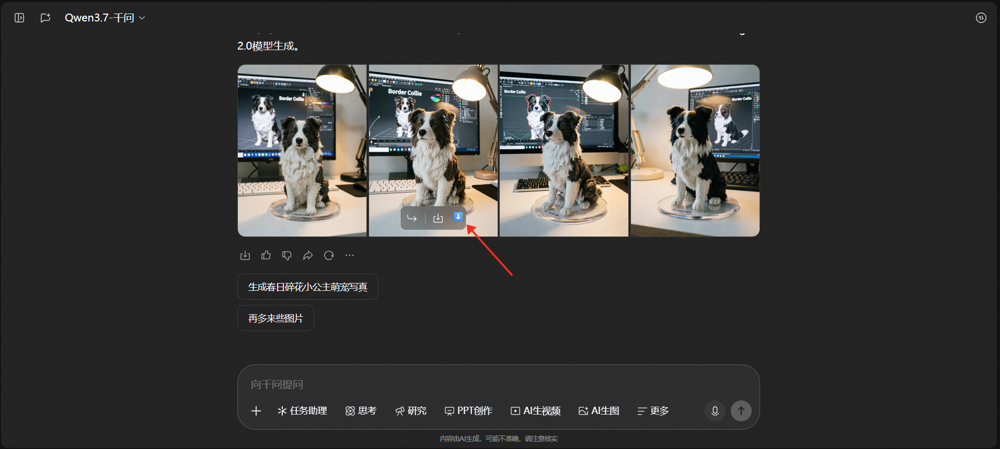
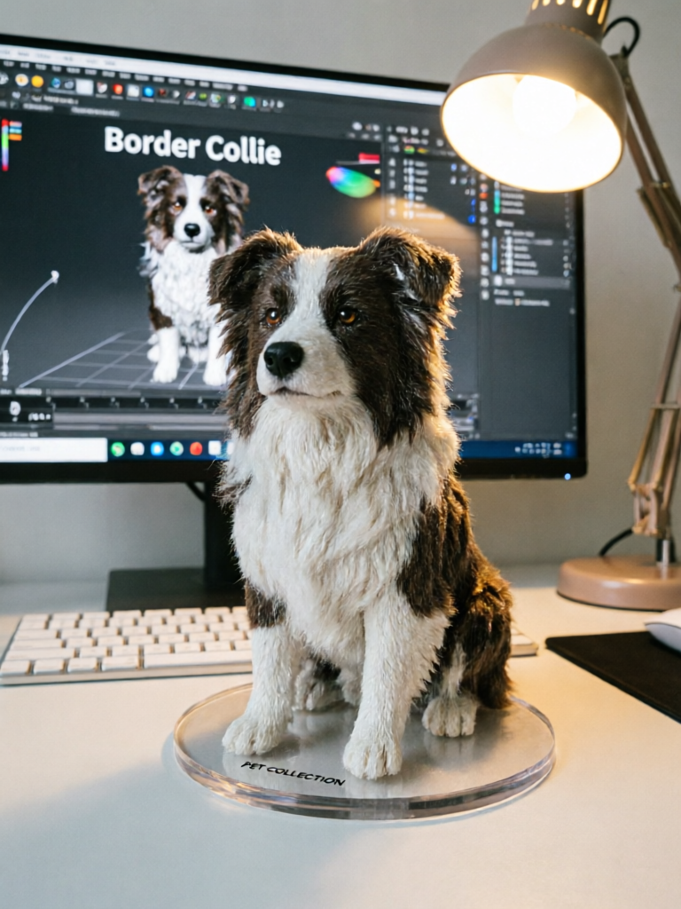

# 千问无水印图片下载

一个用于去除千问 AI 生图下载水印的油猴脚本（Tampermonkey Userscript）。

## 功能特性

- ✅ 自动检测千问聊天页面中的 AI 生成图片
- ✅ 一键下载无水印原图
- ✅ 无需任何第三方依赖，纯原生 JavaScript 实现
- ✅ 自动监听页面变化，新生成的图片也会自动挂载下载按钮

## 安装方法

1. 安装浏览器扩展 [Tampermonkey](https://www.tampermonkey.net/)（或暴力猴 Violentmonkey）
2. 点击浏览器右上角扩展图标 → 添加新脚本
3. 将 `qwen-no-watermark.js` 内容复制粘贴进去，保存即可
4. 打开千问聊天页面，鼠标悬停在 AI 生成的图片上，点击右侧的 ⬇️ 按钮即可下载无水印原图

## 使用效果

### 1. 操作步骤

AI 生成图片后，鼠标悬停在图片上，点击图片右侧出现的 ⬇️ 下载按钮，即可保存无水印原图：



### 2. 效果对比

|         带水印图片（页面直接下载效果）          |        无水印图片（脚本下载效果）         |
|:------------------------------:|:----------------------------:|
|  |  |

## 项目结构

```
qwen-no-watermark/
├── qwen-no-watermark.js   # 油猴脚本主文件
├── LICENSE                # GPL-3.0 开源协议
├── README.md              # 项目说明文档
└── assets/               # 效果展示图片目录
```

## 说明

- 脚本仅匹配 `https://www.qianwen.com/chat/*` 页面
- 下载的图片为原图，无任何水印
- 仅供个人学习交流使用

## License

[GNU General Public License v3.0](LICENSE) (GPL-3.0)

本项目采用 GPL-3.0 协议开源，任何基于本项目的衍生作品必须同样以 GPL-3.0 协议开源。
